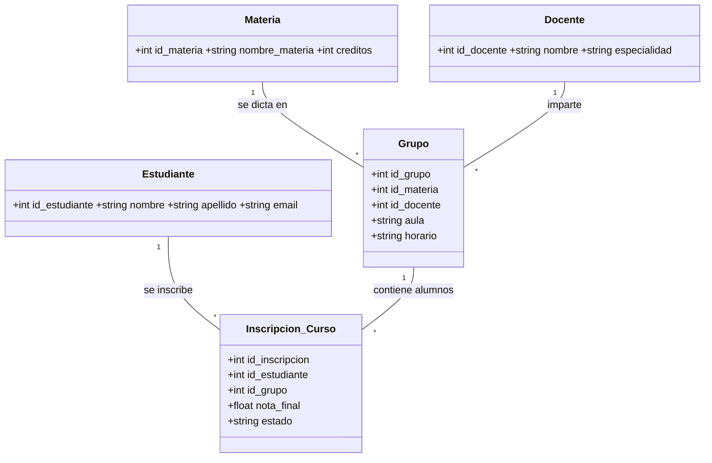

# Sistema Académico UNIAJC (MVC + Base de Datos Remota)

Sistema de gestión académica de escritorio en Java Swing con arquitectura **MVC**
(Entidad, DAO, Servicio, Vista), conexión a una **base de datos remota en Neon (PostgreSQL)**
y contraseñas encriptadas (MD5).

## Requisitos

- JDK 17 o superior
- Maven 3.6+
- Cuenta en Neon (base de datos PostgreSQL remota) — o cualquier PostgreSQL

## Diagrama del ecosistema



## Estructura del proyecto (MVC)

```
src/main/java/com/uniajc/
├── Main.java                 # Punto de entrada (carga la vista login)
├── modelo/                   # Entidades (POJOs): Estudiante, Docente, Materia,
│                             #   Grupo, InscripcionCurso, Usuario, Rol (enum)
├── dao/                      # Data Access Objects (consultas SQL por entidad)
├── servicios/                # Lógica de negocio y validaciones
├── db/
│   ├── DatabaseConexion.java # Conexión JDBC a PostgreSQL (lee config.properties)
│   └── EncriptacionUtil.java  # Utilidad MD5 / SHA-256 para contraseñas
└── vista/                    # Vistas Swing (login, principal, paneles CRUD)
```

## Configuración de la base de datos

1. Crea tu base de datos en **Neon** (o cualquier PostgreSQL remota).
2. Crea el archivo **`config.properties`** en la raíz del proyecto con tus datos:

```properties
HOST=ep-tu-proyecto-pooler.c-X.us-east-2.aws.neon.tech
USER=neondb_owner
PASSWORD=tu-contraseña
DATABASE=neondb
URL=jdbc:postgresql://ep-tu-proyecto-pooler.c-X.us-east-2.aws.neon.tech/neondb?sslmode=require
```

> ⚠ **Importante:** El archivo `config.properties` nunca debe subirse al repositorio
> (está en `.gitignore`). Contiene credenciales reales de la base de datos.

3. Crea las tablas ejecutando el script **`database/esquema.sql`** en el editor SQL de Neon
   (o con `mvn exec:java -Dexec.mainClass="com.uniajc.db.InicializadorBaseDatos"`).

### Tablas creadas

| Tabla | Propósito |
|--------|-----------|
| `users` | Usuarios del sistema (login, roles, contraseña encriptada) |
| `estudiantes` | Estudiantes |
| `docentes` | Docentes |
| `materias` | Materias |
| `grupos` | Grupos (relacionan materia + docente + aula + horario) |
| `inscripciones_curso` | Inscripciones de estudiantes a grupos con nota y estado |

### Usuarios de prueba (contraseñas encriptadas MD5)

| Usuario | Contraseña | Rol |
|---------|-----------|-----|
| `admin` | `admin123` | ADMIN |
| `usuario` | `usuario123` | USUARIO |

## Cómo ejecutar

### 1. Compilar

```bash
mvn clean compile
```

### 2. Ejecutar desde Maven

```bash
mvn exec:java -Dexec.mainClass="com.uniajc.Main"
```

### 3. Generar el ejecutable `.jar`

```bash
mvn clean package
```

Esto genera `target/sistema-academico-mvc.jar` (con Maven Shade Plugin).
Para ejecutarlo:

```bash
java -jar target/sistema-academico-mvc.jar
```

> ⚠ El archivo `config.properties` debe estar **en la misma carpeta que el `.jar`**
> para que la aplicación encuentre la conexión a la base de datos.

### 4. Ejecutar las pruebas

```bash
mvn test
```

## Credenciales de acceso

- **Administrador:** `admin` / `admin123`
- **Usuario normal:** `usuario` / `usuario123`

## Buenas prácticas aplicadas

- Arquitectura en capas: Entidad → DAO → Servicio → Vista.
- Conexión remota vía `config.properties` (sin datos quemados en el código).
- Contraseñas encriptadas con MD5 (se recomienda migrar a SHA-256).
- `enum` para roles (ADMIN / USUARIO).
- ComboBox con ID + etiqueta para las claves foráneas.
- Funciones genéricas reutilizables (creación de botones, paneles CRUD base).
- Generación de `.jar` ejecutable con Maven Shade.

---

*Proyecto académico — UNIAJC, Programación 2.*
