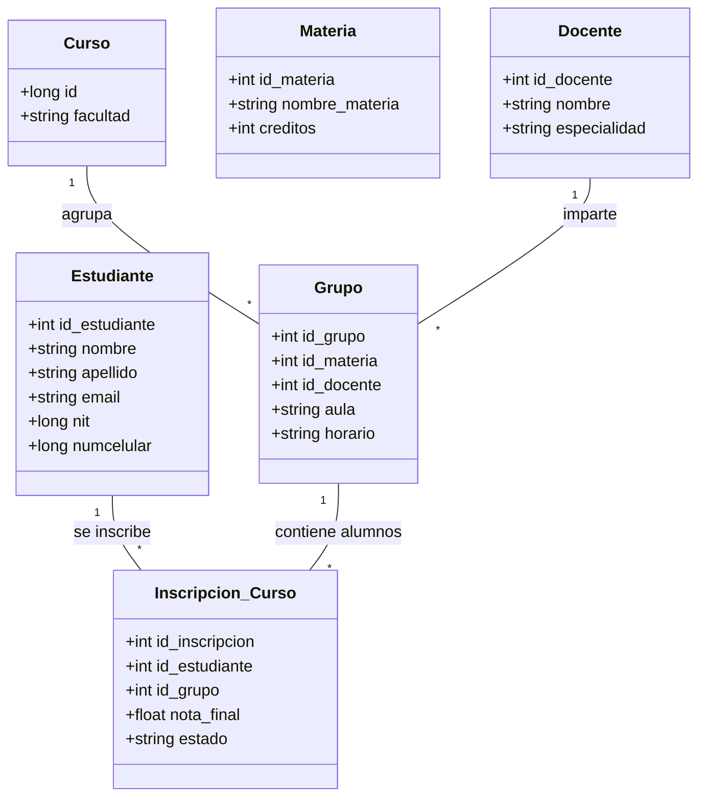
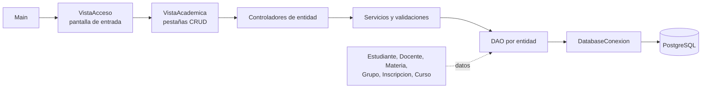

# PRÁCTICA ACADÉMICA - SISTEMA DE GESTIÓN UNIAJC (MVC + DB)

## Objetivo
Replicar el ecosistema académico propuesto en el diagrama Mermaid, siguiendo los estándares de arquitectura en capas (Entidad, DAO, Service, Controller, Vista).

## Diagrama del Ecosistema

## Mapeo de la aplicación

La aplicación es de escritorio y usa **Java 17, Swing, JDBC y PostgreSQL**. Su punto de entrada es `com.uniajc.Main`.

### Capas y módulos

La ventana `VistaAcademica` muestra pestañas con CRUD para estudiantes, docentes, materias, cursos,
grupos e inscripciones. Cada entidad tiene su modelo, DAO, servicio y controlador; los paneles Swing
comparten `CrudTablePanel` para listar, crear, editar y eliminar.

El acceso consulta `public.username`. `UsuarioDAO` obtiene la cuenta, `AutenticacionService` verifica
la contraseña y `ControladorAcceso` conecta el servicio con `VistaAcceso`. El hash nunca se muestra en la
interfaz; la contraseña capturada se pasa como arreglo de caracteres y se borra al terminar el acceso.

## Cómo ejecutar

1. Copia `config.properties.example` como `config.properties` y completa los datos de tu PostgreSQL remoto.
2. Ejecuta `src/main/resources/db/estudiantes.sql` si necesitas instalar o actualizar las rutinas del CRUD.
3. Ejecuta `mvn test` para las pruebas y `mvn package` para generar el JAR ejecutable.
4. Abre `target/SistemaAcademico.jar` e inicia sesión con una cuenta de `public.username`.

## Configuración de BD:
Usa `config.properties` en la raíz del proyecto; puedes partir de [`config.properties.example`](config.properties.example).
La conexión acepta `db.url`, `db.user` y `db.password`, o sus alias `URL`, `USERNAME` y `PASSWORD`.
El archivo con valores reales está ignorado por Git. La contraseña de conexión se guarda ahí como secreto
local: no puede reemplazarse por un hash porque PostgreSQL necesita autenticar la conexión con la credencial
original. La conexión remota usa TLS cuando la URL incluye `sslmode=require`.

Las contraseñas de las cuentas de la aplicación se guardan en `public.username.password` con PBKDF2-HMAC-SHA512,
sal aleatoria y 220 000 iteraciones, siguiendo la guía de [OWASP Password Storage](https://cheatsheetseries.owasp.org/cheatsheets/Password_Storage_Cheat_Sheet.html).
Las cuentas existentes con contraseña antigua se migran al nuevo formato después de un inicio de sesión
correcto; las credenciales no se imprimen ni se muestran en la interfaz.

La base configurada debe tener la tabla `public.estudiante` con `id`, `name`, `lastname`, `email`, `nit`
y `numcelular`. Ejecuta [`src/main/resources/db/estudiantes.sql`](src/main/resources/db/estudiantes.sql) para instalar
las rutinas usadas por el CRUD: `sp_insertar_estudiante` (crear), `fn_listar_estudiantes` (listar),
`sp_actualizar_estudiante` (editar) y `sp_eliminar_estudiante` (eliminar). Luego inicia la aplicación desde
tu IDE usando `com.uniajc.Main`.

Los DAO usan el esquema real `public`, incluyendo el nombre heredado `inscripcion.id_estiante`. En la base
actual, `grupos.id_materia` referencia `curso.id`; por eso el formulario de grupos solicita el ID del curso.
Para ejecutar la compilación y las pruebas unitarias usa `mvn test`.

---
*Recuerda: El Modelo nunca debe hablar con el usuario (sin System.out). El Controlador orquesta y la Vista interactúa.*

Creado para una prueba.
