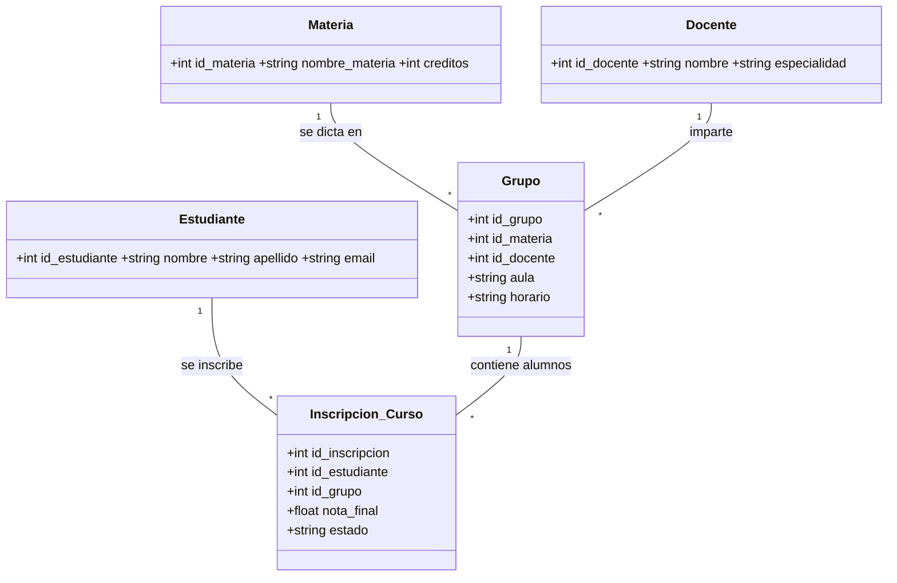

# Sistema Académico UNIAJC (MVC + Base de Datos Remota)

Sistema de gestión académica de escritorio en Java Swing con arquitectura **MVC**
(Entidad, DAO, Servicio, Vista), conexión a una **base de datos remota en Neon (PostgreSQL)**
y contraseñas encriptadas (MD5).

## Requisitos

- JDK 17 o superior
- Maven 3.6+
- Cuenta en Neon (base de datos PostgreSQL remota) — o cualquier PostgreSQL

## Diagrama del ecosistema



## Estructura del proyecto (MVC)

```
src/main/java/com/uniajc/
├── Main.java                 # Punto de entrada (carga la vista login)
├── modelo/                   # Entidades (POJOs): Estudiante, Docente, Materia,
│                             #   Grupo, InscripcionCurso, Usuario, Rol (enum)
├── dao/                      # Data Access Objects + interfaces de repositorio
│   ├── *Repositorio.java     #   Contrato de persistencia por entidad
│   └── *Dao.java             #   Implementación JDBC (implements *Repositorio)
├── servicios/                # Lógica de negocio y validaciones
├── db/
│   ├── DatabaseConexion.java # Conexión JDBC a PostgreSQL (lee config.properties)
│   └── EncriptacionUtil.java  # Utilidad MD5 / SHA-256 para contraseñas
└── vista/                    # Vistas Swing (login, principal, paneles CRUD)

src/test/java/com/uniajc/
├── dao/                      # Dobles en memoria de cada repositorio
├── servicios/                # Pruebas unitarias de las 6 capas de servicio
└── db/                       # Pruebas de EncriptacionUtil

database/
├── esquema.sql               # Tablas + datos iniciales
└── procedimientos.sql        # Funciones y procedimientos almacenados
```

### Inversión de dependencias en la capa de persistencia

Cada entidad define una interfaz de repositorio (`EstudianteRepositorio`,
`DocenteRepositorio`, …) y su DAO JDBC la implementa. Los servicios dependen de la
interfaz, no de la clase concreta:

```java
public EstudianteService(EstudianteRepositorio estudianteDao) { … }
```

Esto permite sustituir la base de datos por un doble en memoria durante las pruebas,
sin tocar la lógica de negocio y sin necesitar conexión a Neon para ejecutar los tests.

## Configuración de la base de datos

1. Crea tu base de datos en **Neon** (o cualquier PostgreSQL remota).
2. Crea el archivo **`config.properties`** en la raíz del proyecto con tus datos:

```properties
HOST=ep-tu-proyecto-pooler.c-X.us-east-2.aws.neon.tech
USER=neondb_owner
PASSWORD=tu-contraseña
DATABASE=neondb
URL=jdbc:postgresql://ep-tu-proyecto-pooler.c-X.us-east-2.aws.neon.tech/neondb?sslmode=require
```

> ⚠ **Importante:** El archivo `config.properties` nunca debe subirse al repositorio
> (está en `.gitignore`). Contiene credenciales reales de la base de datos.

3. Crea las tablas ejecutando el script **`database/esquema.sql`** en el editor SQL de Neon
   (o con `mvn exec:java -Dexec.mainClass="com.uniajc.db.InicializadorBaseDatos"`).

4. Crea las funciones y procedimientos almacenados con **`database/procedimientos.sql`**.

   Si ya tenías las tablas creadas y solo quieres aplicar/actualizar las rutinas
   (son `CREATE OR REPLACE`, así que se pueden re-ejecutar sin duplicar datos):

   ```bash
   mvn exec:java -Dexec.mainClass="com.uniajc.db.InicializadorBaseDatos" -Dexec.args="solo-rutinas"
   ```

   > ⚠ Ejecutar el inicializador **sin** `solo-rutinas` vuelve a correr `esquema.sql`
   > completo. Sus `INSERT` de docentes, materias, grupos e inscripciones no tienen
   > `ON CONFLICT`, así que duplicarían esos registros.

### Tablas creadas

| Tabla | Propósito |
|--------|-----------|
| `users` | Usuarios del sistema (login, roles, contraseña encriptada) |
| `estudiantes` | Estudiantes |
| `docentes` | Docentes |
| `materias` | Materias |
| `grupos` | Grupos (relacionan materia + docente + aula + horario) |
| `inscripciones_curso` | Inscripciones de estudiantes a grupos con nota y estado |

### Rutinas almacenadas

Definidas en **`database/procedimientos.sql`** (PostgreSQL). La lógica de negocio
—validaciones, reglas— sigue en la capa de servicio Java; lo que se delega al motor
de base de datos es el trabajo sobre los datos.

| Rutina | Tipo | Qué hace | Cómo se invoca desde Java |
|--------|------|----------|---------------------------|
| `fn_estado_por_nota(nota)` | Función | Traduce una nota a APROBADO / REPROBADO | `SELECT` con `PreparedStatement` |
| `fn_promedio_grupo(id_grupo)` | Función | Promedio de notas de un grupo (0 si está vacío) | `SELECT` con `PreparedStatement` |
| `sp_asignar_nota(id_inscripcion, nota)` | Procedimiento | Asigna la nota y recalcula el estado | `CALL` con `CallableStatement` |

**Función vs. procedimiento** (la distinción que se trabajó en clase):

- Una **función** solo lee, siempre retorna un valor, y se llama dentro de un `SELECT`.
- Un **procedimiento** puede modificar datos (`UPDATE`/`INSERT`) y se invoca con `CALL`;
  no retorna un valor, produce su efecto.

Desde Java, `InscripcionDao` usa `CallableStatement`. El procedimiento se invoca con
`CALL` explícito:

```java
private static final String SP_ASIGNAR_NOTA = "CALL public.sp_asignar_nota(?, ?)";
```

> ⚠ **No uses el escape JDBC `{call ...}`** para este procedimiento. El driver de
> PostgreSQL lo traduce a `SELECT * FROM sp_asignar_nota(...)` (su
> `escapeSyntaxCallMode` por defecto es `select`), y el motor responde
> `is a procedure. Hint: To call a procedure, use CALL`.
> Las funciones, en cambio, sí se invocan con `SELECT` como cualquier consulta.

En la interfaz, el botón **“Asignar nota…”** del panel de Inscripciones usa el
procedimiento almacenado y muestra el promedio calculado por la función.

### Usuarios de prueba (contraseñas encriptadas MD5)

| Usuario | Contraseña | Rol |
|---------|-----------|-----|
| `admin` | `admin123` | ADMIN |
| `usuario` | `usuario123` | USUARIO |

## Cómo ejecutar

### 1. Compilar

```bash
mvn clean compile
```

### 2. Ejecutar desde Maven

```bash
mvn exec:java -Dexec.mainClass="com.uniajc.Main"
```

### 3. Generar el ejecutable `.jar`

```bash
mvn clean package
```

Esto genera `target/sistema-academico-mvc.jar` (con Maven Shade Plugin).
Para ejecutarlo:

```bash
java -jar target/sistema-academico-mvc.jar
```

> ⚠ El archivo `config.properties` debe estar **en la misma carpeta que el `.jar`**
> para que la aplicación encuentre la conexión a la base de datos.

### 4. Ejecutar las pruebas

```bash
mvn test
```

Las pruebas unitarias (JUnit 5) **no requieren conexión a la base de datos**: usan
dobles en memoria que implementan las interfaces de repositorio.

| Clase de prueba | Qué cubre |
|-----------------|-----------|
| `EstudianteServiceTest` | CRUD, validación de nombre/apellido/email |
| `DocenteServiceTest` | CRUD, validación de nombre y especialidad |
| `MateriaServiceTest` | CRUD, rango de créditos (1–10) |
| `GrupoServiceTest` | CRUD, materia/docente obligatorios, aula y horario |
| `InscripcionServiceTest` | CRUD, nota 0–5, estados válidos, duplicados, rutinas almacenadas |
| `UsuarioServiceTest` | Autenticación, hash de contraseña, usuarios inactivos |
| `EncriptacionUtilTest` | Hashes MD5/SHA-256 contra valores conocidos |

Resultado actual: **98 pruebas, 0 fallos**.

## Credenciales de acceso

- **Administrador:** `admin` / `admin123`
- **Usuario normal:** `usuario` / `usuario123`

## Buenas prácticas aplicadas

- Arquitectura en capas: Entidad → DAO → Servicio → Vista.
- Conexión remota vía `config.properties` (sin datos quemados en el código).
- Contraseñas encriptadas con MD5 (se recomienda migrar a SHA-256).
- `enum` para roles (ADMIN / USUARIO).
- ComboBox con ID + etiqueta para las claves foráneas.
- Funciones genéricas reutilizables (creación de botones, paneles CRUD base).
- Inversión de dependencias: los servicios dependen de interfaces de repositorio,
  lo que permite probarlos sin base de datos real.
- Procedimientos y funciones almacenadas en la base de datos, invocadas desde Java
  con `CallableStatement`; la lógica de negocio permanece en la capa de servicio.
- Pruebas unitarias con JUnit 5 en las 6 entidades del dominio.
- Generación de `.jar` ejecutable con Maven Shade.

---

*Proyecto académico — UNIAJC, Programación 2.*
